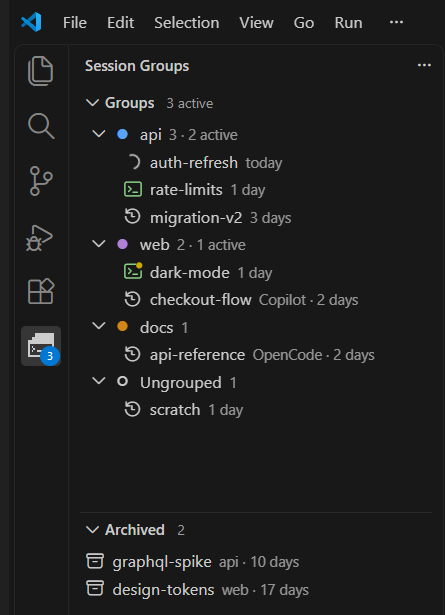

# Session Groups

Keep your coding-agent sessions in your own groups, and resume any of them with a click.

- **Groups you define**, each with its own folder, colour and agent.
- **Real terminals.** Sessions survive restarts, and a click resumes one.
- **See what is running**, and for Claude Code and OpenCode, whose turn it is.
- **Archive and search** your sessions.
- **Built-in agents:** Claude Code, OpenCode, GitHub Copilot CLI, Gemini CLI, Qwen Code and Goose; add your own in the settings.

The agent's command-line tool must be installed.

Full documentation, settings and source: [github.com/hboulal/session-groups](https://github.com/hboulal/session-groups)
