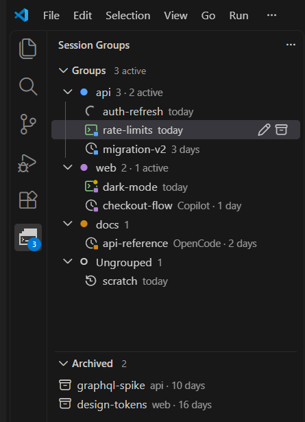
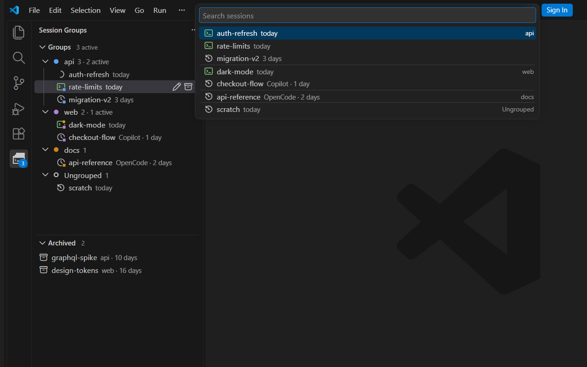

# Session Groups

Your coding-agent sessions, in your own groups, one click from being resumed.

Session Groups is a VS Code side panel for terminal coding agents such as Claude Code, OpenCode, GitHub Copilot CLI, Gemini CLI, Qwen Code and Goose. Each session runs in a real VS Code terminal. Sessions stay listed after VS Code restarts, and a click resumes one where you left it.





## Features

- **Your own groups.** A group has a name, a colour, the folder its sessions start in, the shell its terminals use and the agent its "+" starts. Sessions without a group are listed under **Ungrouped**.
- **Resume with a click.** Clicking a session resumes it in a terminal, or brings its terminal to the front if it is already open. A running session survives a window reload.
- **See what is running.** A session with an open terminal has a green terminal icon. For Claude Code and OpenCode the icon also shows whose turn it is:
  - it spins while the agent works;
  - it is green when it is your turn;
  - it gets a yellow dot when the agent finished while you were looking elsewhere, with a notification that offers to open it.
- **Follows your terminals.** Picking a session's terminal selects its row in the panel.
- **Counts at a glance.** Each group shows how many sessions it has and how many are running (`5 · 2 active`). The view title and the activity-bar badge show the total running.
- **Names follow the agent.** Terminal tabs show the title Claude Code sets, and `/rename` inside Claude also renames the session in the panel.
- **Archive.** Archived sessions move to their own view and cannot be opened until they are unarchived. Clear Archived removes them all from the list.
- **Search.** Search Sessions lists every session under its group and opens the one you pick.
- **Mixed agents.** One group can hold sessions of different agents; each session always resumes with the agent it started with.
- **Add existing sessions.** Add Existing Session lists a session you started elsewhere, by its id.

Nothing is deleted from the agents themselves: removing or archiving a session only changes the panel's list. Groups and sessions are stored by VS Code on your computer.

## Using it

- **New group:** the new-folder button in the Groups view title.
- **New session:** the "+" on a group, or on Ungrouped.
- **Session with another agent:** right-click a group and choose New Session With…
- **Group settings:** the gear on a group opens a menu to rename it, change its colour, folder or agent, or delete it.
  - Delete Group moves its sessions to Ungrouped.
  - Delete Group and Sessions removes them too, after a confirmation.
- **Session actions:** inline Rename and Archive buttons; right-click for Open, Close Terminal, Edit Session ID and Delete.
- **Keys:** F2 renames the selected row. Delete archives the selected session in Groups, and deletes it from Archived after a confirmation.
- **View title buttons:**
  - search;
  - show only running sessions (lightning);
  - show sessions without groups, labelled `group/session`;
  - in the "…" menu, Enable Reorder (drag and drop is off by default) and Hide Group Colors.

## Agents

| Agent | Starts with | Resumes with |
|---|---|---|
| Claude Code | `claude --session-id <id>` | `claude --resume <id>` |
| OpenCode | `opencode --session <id>` | `opencode --session <id>` |
| GitHub Copilot CLI | `copilot --session-id <id>` | `copilot --resume <id>` |
| Gemini CLI | `gemini --session-id <id>` | `gemini --resume <id>` |
| Qwen Code | `qwen --session-id <id>` | `qwen --resume <id>` |
| Goose | `goose session -n <id>` | `goose session --resume -n <id>` |

The agent's command-line tool must be installed and logged in. Any other agent works if it can start a session with an id given to it. Add it in your settings:

```json
"sessionGroups.agents": [
  { "id": "x", "name": "X", "start": "x --session {id}", "resume": "x --resume {id}" }
]
```

Two optional fields:
- `idPrefix` makes new ids start with that prefix.
- `idPattern` is a regular expression that ids typed by hand must match.

Agents such as Codex, which pick their own session id at start, are not supported.

## Settings

| Setting | Default | What it does |
|---|---|---|
| `sessionGroups.defaultFolder` | empty | Folder that sessions without a group start in, and the folder a new group starts from |
| `sessionGroups.defaultAgent` | `claude` | Agent for sessions without a group and for groups with none chosen |
| `sessionGroups.agents` | `[]` | Extra agents, or replacements for built-in ones (same `id`) |
| `sessionGroups.notifyWhenFinished` | `true` | Notify when a Claude Code or OpenCode session finishes while its terminal is not in front |

## Limits

- **Turn status:** shown for Claude Code and OpenCode only. A Claude session waiting on a permission prompt shows as working.
- **One window:** VS Code windows do not see each other's terminals, so "running" means running in this window.
- **One computer:** the lists are not synced between computers.

## Development

```bash
npm ci
npm run typecheck && npm test && npm run build
npm run package   # builds session-groups-<version>.vsix
```

Every push to `main` that changes the extension (code, media, `package.json` or `MARKETPLACE.md`) is checked, gets the next patch version and is published to the Marketplace by the `Publish` workflow; the version bump is committed back as `Release x.y.z` with a `vx.y.z` tag. Changes to the docs only are not published.

## License

MIT
